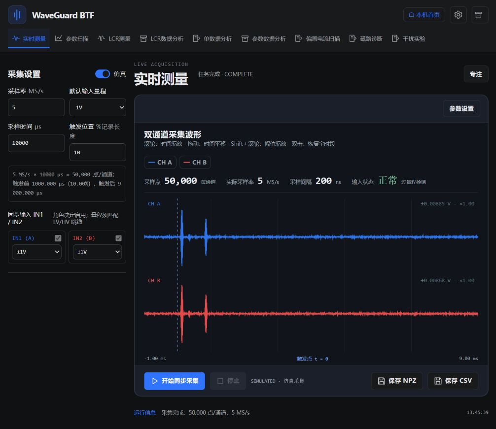

# WaveGuard BTF · Red Pitaya

`btf` 分支：以 `Pico_4824A_btf` 工作站为功能与界面参考，移植到 **STEMlab 125-14 Pro Z7020 Gen2**。本地独立目录为 `software/red_pitaya_btf`；不修改 Pico 参考目录或原 `red_pitaya` 项目。

这是可运行的软件移植版，不是全部实机验收通过的声明。当前完成本机仿真、API、算法与浏览器验收；此次未部署到板卡、未连接电源或产生真实输出。

## 本机启动

```powershell
.\start-local.ps1
# 或指定 Python / 端口
.\start-local.ps1 -PythonExe "C:\path\to\python.exe" -Port 4826
```

打开 **http://127.0.0.1:4826/measure**。实时测量请主动打开“仿真”；偏置扫描默认仿真。所有模拟记录保存 `simulated: true`，不自动以模拟数据代替失联硬件。

跨平台启动：安装 `app/requirements.txt`，在 `app` 目录执行：

```sh
python -m redscope.server --host 127.0.0.1 --port 4826
```

## 工作站页面

保留 BTF 共享 Shell / Stage / Inspector 与深浅色设置：实时测量、参数扫描、LCR 测量、LCR 数据分析、单数据分析、参数数据分析、偏置电流扫描、磁路诊断预览、干扰历史分析。默认深色；所有网页资源与线性图标均本地提供。

新增命名设置、只读文件选择器、任务 ZIP、NPZ/CSV+JSON 同会话保存、偏置 × 激励幅值扫描、PZT 滤波评价、重复统计与误差棒、USB 电源故障恢复。大部分高级参数保留在右侧 Inspector，文件/系统工具位于顶部抽屉。

详细范围与限制见 [功能对照表](docs/BTF_FEATURE_MATRIX.md) 和 [移植设计](docs/BTF_DESIGN.md)。



## 必须知道的硬件边界

- 现场仅 IN1(A)、IN2(B)，历史 Pico A–H 仍可离线分析。LV/HV 为物理跳线；DC 耦合，不支持软件自动量程。
- 实时采集保留 OUT1、OUT2、轮流四路径、双输出同边沿起发和载波固定相位差。默认 5 MS/s、10 ms、0.1 Vpp；不支持的采样率和记录长度直接报错。
- 偏置扫描选定单个 OUT1 或 OUT2，使用 PZT 加一路可选电压/电流监测；不能同时测三个独立信号。三路波形保护和三路线性度现场采集不可用。
- IT6524D 控制是可选 USB 功能。额外安装 `app/requirements-bias.txt`，并在**实际运行 Python 的主机**接入电源。板端 USB 驱动与电源闭环尚未实测。不要把电源功率输出或功放高压直接接入 ADC。
- 实机偏置必须填写电压、总通电时限、稳定超时、冷却和实际电流上限。默认上限 6 A；21.65 A 是参考负载/电源的配置边界，不是线圈安全认证。软件保护不保证强杀/断电/USB 故障时断电；独立保护和线圈温度适配器未接入。板卡温度不等于线圈温度。
- 磁路诊断仅模型预览，实机启动锁定；干扰实验只开放历史归档导入与分析。

## 数据与部署

默认本机数据保存在 `app/data/`。板端沿用环境变量 `HANNSCOPE_DATA`，推荐 `/home/redpitaya/hann_scope_data`，命名设置也保存在该数据目录。参考目录不作为输出路径。原始数据、依赖、二进制和测试临时数据不上传 Git。

将来部署沿用 `hann_scope` 应用 ID、`/opt/redpitaya/www/apps/hann_scope` 路径及板端端口 **4825**，会替换同入口的主线版，不与旧控制器同时运行。`deploy-v2.ps1` 包含备份，`-Rollback` 可回退；本次没有执行部署。新 C++ `OFF` 指令需要与 Python 服务一起更新，不能只覆盖网页/Python。

`waveguard-studio/` 是主线遗留的独立 React 演示原型，不是本分支当前工作站。`archive/` 保留旧 Hann 前端与一次性迁移记录。

## 验证

```sh
python tools/check.py
python tools/compare-btf-reference.py --source ../Pico_4824A_btf
python tools/verify-btf-source.py --source ../Pico_4824A_btf
```

首项在隔离数据目录运行板卡仿真、HTTP、算法与偏置保护故障测试，不访问实机。后两项只读对比外部 Pico 参考；GitHub CI 不依赖该外部目录。算法对比报告：[btf-algorithm-regression.json](docs/btf-algorithm-regression.json)。参考源码指纹：[btf-source-manifest.json](docs/btf-source-manifest.json)。验收记录：[BTF_VALIDATION.md](docs/BTF_VALIDATION.md)。
